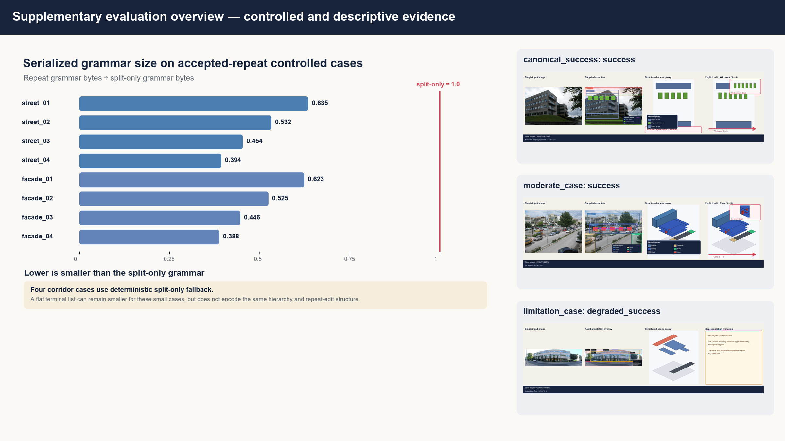

# SceneGrammarKit

SceneGrammarKit is a deterministic Python toolkit for representing coarse
semantic scene structure with executable split-and-repeat grammars. It provides
strict JSON models, bounded geometry execution, headless rendering, typed
structural edits, annotation-assisted construction, and an offline evaluation
pipeline.



The project is an early research prototype. It is designed for transparent,
inspectable experiments rather than automatic image understanding or
photorealistic reconstruction.

## Highlights

- Strict, versioned grammar and annotation schemas
- Deterministic canonical JSON, PNG, and GLB artifact generation
- CPU-only rendering with no display server, GPU, OpenGL, or system font
- Safe output handling with explicit overwrite controls
- Immutable edits addressed by stable node identifiers
- Frozen controlled cases plus attributed Open Images examples
- A broad automated test suite and multi-version continuous integration

## How it fits together

```text
grammar JSON ──> validate ──> execute ──> primitives + GLB ──> render
      │                         │
      └─────────────────────────┴────────> typed structural edits

image + supplied annotation ──> lift ──> split/repeat induction ──> grammar
```

The image workflow is explicitly annotation-assisted: semantic regions,
hierarchy, depth zones, split hints, and repeat groups are researcher supplied.
See [the scope boundary](protocols/evaluation_v0_1/scope.md) for the supported
claims and non-claims.

## Quick start

Python 3.11 or newer is required. The locked setup uses
[uv](https://docs.astral.sh/uv/):

```bash
uv sync --extra dev --frozen
uv run scene-grammar doctor
uv run pytest
```

Standard `venv` and `pip` also work:

```bash
python -m venv .venv
python -m pip install -e ".[dev]"
python -m scene_grammar_kit doctor
python -m pytest
```

On Windows, activate a `venv` with `.venv\Scripts\Activate.ps1`; on macOS or
Linux use `source .venv/bin/activate`.

## Core usage

Validate and inspect a grammar:

```bash
scene-grammar validate tests/fixtures/grammars/valid_nested_urban.json
scene-grammar inspect tests/fixtures/grammars/valid_nested_urban.json
```

Execute and render it:

```bash
scene-grammar execute tests/fixtures/grammars/valid_nested_urban.json \
  --out runs/example

scene-grammar render tests/fixtures/grammars/valid_nested_urban.json \
  --output runs/example/semantic.png \
  --camera isometric \
  --width 1200 \
  --height 800
```

Build a complete example bundle:

```bash
scene-grammar build-scene-example \
  examples/scene_examples/urban_street/scene_manifest.json \
  --out runs/urban_street
```

The Python API exposes the same primitives:

```python
from scene_grammar_kit.geometry import execute_grammar
from scene_grammar_kit.grammar import load_grammar, validate_grammar

grammar = load_grammar("tests/fixtures/grammars/valid_nested_urban.json")
report = validate_grammar(grammar)
if not report.is_valid:
    raise ValueError(report.diagnostics)

scene = execute_grammar(grammar)
print(scene.report.primitive_count)
```

## Reproducing the tracked evidence

The full CPU-only workflow rebuilds the attributed examples, audits their
provenance and deterministic artifacts, and regenerates the controlled
evaluation:

```bash
uv run scene-grammar build-open-images-cases \
  --output results/real_cases --all --verify-determinism --overwrite

uv run scene-grammar phase2-acceptance \
  --cases inputs/real_cases \
  --results results/real_cases \
  --output results/phase2_acceptance \
  --verify-determinism --overwrite

uv run scene-grammar evaluate \
  --output results/evaluation --verify-determinism --overwrite
```

Convenience wrappers are available as `scripts/reproduce.sh` and
`scripts/reproduce.ps1`. Exact assumptions, expected outputs, and verification
steps are documented in [REPRODUCIBILITY.md](REPRODUCIBILITY.md).

## Repository map

| Path | Purpose |
| --- | --- |
| `src/scene_grammar_kit/` | Installable implementation and CLI |
| `tests/` | Unit, integration, determinism, and regression tests |
| `examples/scene_examples/` | Small hand-authored grammar examples |
| `evaluation/benchmark_v0_1/` | Frozen controlled evaluation inputs |
| `inputs/real_cases/` | Attributed images and supplied annotations |
| `results/` | Reproducible reference outputs and summaries |
| `protocols/evaluation_v0_1/` | Versioned scope and metric contract |
| `docs/` | Detailed workflow and data-model documentation |

## Data and attribution

The three tracked photographs are Open Images V7 validation images distributed
under CC BY 2.0. Their individual authors, source pages, hashes, and license
links are recorded in each case manifest and in
[`results/phase2_acceptance/ATTRIBUTION.md`](results/phase2_acceptance/ATTRIBUTION.md).
The Open Images annotation license is recorded separately as CC BY 4.0.
See [`datasets/open_images/LICENSE_NOTES.md`](datasets/open_images/LICENSE_NOTES.md).

## License

SceneGrammarKit source code and project documentation are licensed under the
[Apache License 2.0](LICENSE). The Open Images photographs and annotation
metadata retain their respective Creative Commons licenses and are not
relicensed under Apache-2.0. See [NOTICE](NOTICE) for the applicable notices.

## Limitations

- Scene structure is supplied through annotations; it is not inferred from pixels.
- Geometry is a coarse, axis-aligned semantic proxy rather than metric 3D.
- Curved, oblique, and receding structures are approximated by bounding boxes.
- The three real-image examples are qualitative and are not an accuracy estimate.
- The API and schemas are pre-1.0 and may change between releases.

## Contributing and security

Bug reports and focused improvements are welcome. Read
[CONTRIBUTING.md](CONTRIBUTING.md) before opening a change. Please report
security-sensitive issues using the private process in [SECURITY.md](SECURITY.md).
